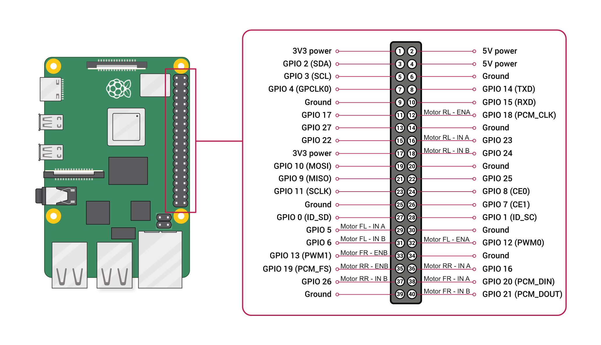

# rosbot

ROS 2 control software for a four-wheel omniwheel robot running on a Raspberry Pi. The active package targets ROS 2 Jazzy and is located at `ROS/colcon_workspace/src/rosbot`. The `ROS/rosbot.old__TMP!__migrating_to_ros2_!/` directory is a legacy ROS 1 archive; its nodes and launch files are not used by the ROS 2 build.

## Requirements

- ROS 2 Jazzy on Ubuntu. For Raspberry Pi installation, see the [ROS 2 Raspberry Pi installation guide](https://docs.ros.org/en/jazzy/How-To-Guides/Installing-on-Raspberry-Pi.html).
- `colcon` and `rosdep`.
- On the robot: gpiozero for GPIO control and `python3-evdev` for keyboard teleoperation with key-release detection.
- Optional devices: a Linux-compatible gamepad, a libcamera-supported Raspberry Pi camera with `camera_ros`, and/or a Hokuyo URG-LX04-UG01 with `urg_node`.

## One-time setup

Do these steps once for each computer or Raspberry Pi where you want to build or run the package.

### 1. Get the source

```bash
git clone https://github.com/markusk/rosbot.git
cd rosbot
```

If the repository is already cloned, use its existing directory instead.

### 2. Install ROS dependencies and build

```bash
source /opt/ros/jazzy/setup.bash
cd ROS/colcon_workspace
rosdep install --from-paths src --ignore-src -r -y
colcon build --symlink-install --packages-select rosbot
```

`rosdep install` installs the package dependencies, including the ROS joystick, camera, and laser drivers. Optional devices still need to be physically connected and configured. Re-run dependency installation if package dependencies change; rebuild after changing source code.


### 3. Configure the Raspberry Pi for motor GPIO (robot only)

Motor GPIO access is enabled only when the system hostname is exactly `rosbot`. Set the hostname once on the robot and reboot if it changed:

```bash
sudo hostnamectl set-hostname rosbot
hostname
```

Install gpiozero on the Raspberry Pi:

```bash
sudo apt-get update
sudo apt-get install python3-gpiozero python3-evdev
```

gpiozero accesses GPIO directly through its selected pin factory and does not require a separate GPIO daemon or systemd service.

The keyboard teleoperation node uses Linux input events for direct-attached keyboards and falls back to terminal input for SSH sessions or inaccessible local devices. For immediate key-release detection on a directly attached keyboard, grant the robot user access to input devices by adding it to the `input` group, then log out and back in:

```bash
sudo usermod -aG input "$USER"
```

Keyboard settings are ROS parameters loaded from a YAML file at launch time. By default, the launch uses `~/.config/rosbot/teleop.yaml` when it exists; otherwise it falls back to the package's `config/teleop.yaml`. To create your personal configuration, copy the package template once:

```bash
mkdir -p ~/.config/rosbot
cp "$(ros2 pkg prefix rosbot)/share/rosbot/config/teleop.yaml" ~/.config/rosbot/teleop.yaml
```

Edit the personal file and restart the launch to apply changes; no rebuild is needed for edits to this external file. At startup, the launch prints the selected configuration path. An alternate file can be selected with `teleop_config:=/path/to/teleop.yaml`. Configure `input_mode` as `auto`, `evdev`, or `terminal`, `key_repeat_timeout`, the separate translation and angular ramp scales, `angular_speed`, and `acceleration_duration`. Terminal mode stops after a short pause without repeated key characters (0.3 seconds by default); local `evdev` mode stops on key release.

On any host whose name is not `rosbot`, the motor node does not access GPIO and simulates motor output. Do not set the robot hostname on a development computer.

### 4. Optional device setup

- **Joystick:** Connect a supported gamepad to Linux. To diagnose the Linux device, install the `joystick` package (`sudo apt-get install joystick`) and run `jstest --normal /dev/input/js0`. The ROS `joy` driver is installed through `rosdep`.
- **Camera:** Connect a camera supported by the Pi's libcamera version. The `camera_ros` driver is installed through `rosdep`.
- **Hokuyo laser:** Connect the URG-LX04-UG01 over USB. Confirm its serial device and supported baud rate on the robot; prefer a stable path under `/dev/serial/by-id/` when available.

Camera and laser launches are restricted to the host whose name is exactly `rosbot`. Their physical operation has not been verified; the scanner's base-to-laser transform must also be measured before use for navigation.

## Start the robot later

Do these steps in each new terminal session. No dependency installation or rebuild is needed unless dependencies or source code have changed.

### 1. Source ROS 2 and the workspace

```bash
source /opt/ros/jazzy/setup.bash
cd ~/rosbot/ROS/colcon_workspace
source install/setup.bash
```

If the repository is in a different location, replace `~/rosbot` with its path.

### 2. Start the standard launch

```bash
ros2 launch rosbot rosbot_launch.py
```

This starts the motor controller, command arbitrator, and keyboard teleoperation. The keyboard node reads Linux input events and requires access to the configured keyboard device; an interactive terminal is not needed for keyboard input. Hold a movement key to drive and release it to stop; press `ESC` on the keyboard or `Ctrl+C` in the launch terminal to stop all launched nodes. On the robot, make the first movement tests with the wheels raised and at low speed; the software watchdog is not a physical emergency stop.

### Start with optional devices

Add launch arguments to the same command when you want to use an optional device:

```bash
ros2 launch rosbot rosbot_launch.py joystick_enabled:=true joy_device_id:=0
ros2 launch rosbot rosbot_launch.py camera_enabled:=true
ros2 launch rosbot rosbot_launch.py laser_enabled:=true
```

The laser defaults to `/dev/ttyACM0`, baud `115200`, and frame `laser`. Override the serial settings if needed:

```bash
ros2 launch rosbot rosbot_launch.py laser_enabled:=true laser_device:=/dev/serial/by-id/your-hokuyo laser_baud:=115200 laser_frame_id:=laser
```

Combine multiple options in one launch command, for example `joystick_enabled:=true camera_enabled:=true`. The joystick requires a supported Linux device. Camera and laser nodes only start on the robot hostname `rosbot`.

## After changing the source

From the workspace directory, rebuild and source the updated package in each terminal that will use it:

```bash
cd ~/rosbot/ROS/colcon_workspace
colcon build --symlink-install --packages-select rosbot
source install/setup.bash
```

If `package.xml` dependencies changed, run `rosdep install --from-paths src --ignore-src -r -y` before building.

## Raspberry Pi 5 and L298N pin assignments

The code uses **BCM GPIO numbers**. Physical pin numbers refer to positions on the Raspberry Pi's 40-pin header. Both numbers are listed below; do not confuse them. The GPIO assignments are unchanged from earlier Raspberry Pi models with the same 40-pin header.

### Raspberry Pi 5 GPIO pinout



### L298N motor controller wiring


Remove the corresponding jumpers on the L298N modules when using PWM on ENA/ENB. GPIO 18 (physical pin 12) is assigned to the rear-left wheel's enable input; the separate LED PWM test uses the same GPIO and must not run at the same time as motor control.

**Safety:** Raspberry Pi GPIOs use 3.3 V logic and are not 5 V tolerant. Do not connect motors directly to the Pi; power them through the L298N drivers. The Pi and motor drivers must share a common ground. Check the wiring and header orientation before powering on; perform initial movement tests with the wheels raised and at low speed.

For more information about nodes, joystick control, and hardware limitations, see the [package README](ROS/colcon_workspace/src/rosbot/README.md).
